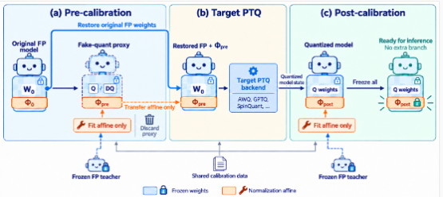

# SandwichQuant

Normalization-affine calibration around post-training quantization (PTQ).

<p align="center">
  
</p>

## Overview

SandwichQuant places two affine-calibration stages around a target PTQ
procedure:

1. **Pre-calibration:** optimize normalization-affine parameters using a
   quantized proxy while keeping its non-affine weights fixed.
2. **Target PTQ:** transfer the learned affine parameters to the original
   full-precision weights, then apply the target quantization procedure.
3. **Post-calibration:** hold quantized weights and quantizer settings fixed
   and adapt normalization-affine parameters again.

The FP teacher supervises affine calibration, not the target PTQ stage.
Calibration data can also supply the target backend's statistics.

## Source layout

| Path | Purpose |
| --- | --- |
| `nap_llm/` | Model loading, affine optimization, data preparation, and evaluation |
| `run_job.py` | Weight-only PTQ and post-calibration |
| `run_order_w3a16.py` | Weight-only four-order comparison |
| `run_w2a4kv4.py` | Rotation-aware W2A4KV4 reference path |
| `run_order_w2a4kv4.py` | Rotation-aware four-order comparison |
| `configs/` | Portable configuration examples |
| `scripts/` | External-backend launchers and result reporting |
| `tests/` | Lightweight source and workflow checks |

`nap_llm` is retained as the internal module name for compatibility.
This repository contains source code, not model weights, datasets, private
experiment records, or manuscript files.

## Installation

Use Python 3.10 or newer. Install a PyTorch build appropriate for your accelerator
first. Do not replace a vendor-specific PyTorch installation with an unrelated
wheel.

```bash
python -m pip install -e .
# Optional downstream-task evaluation:
python -m pip install -e ".[evaluation]"
```

For an already provisioned offline environment:

```bash
python -m pip install -e . --no-deps --no-build-isolation
```

The published launchers use local model and dataset directories. Set them
explicitly; there are no embedded machine or account paths.

## External quantization backends

RTN is implemented in `nap_llm/quantize.py`. The optional GPTQModel adapter and
external research-backend adapters are separate execution paths and should not
be treated as numerically interchangeable.

Third-party source code is **not bundled**. In particular, the rotation-aware
path expects a compatible external ResComp/GPTAQ-style checkout. See
[backend setup](docs/backends.md) before launching it. Backend names in the
overview are integration examples, not a guarantee that every backend supports
every bit width, architecture, or device.

## Weight-only example

Prepare the local dataset layout described in [data and evaluation](docs/data.md).
Then set local paths:

```bash
export MODEL_PATH=/path/to/model
export DATA_ROOT=/path/to/quantization-data

python prepare_local_data.py --data-root "$DATA_ROOT"

# RTN + post-calibration: a weight-only pipeline example, not full SandwichQuant.
# Skip downstream tasks until their local dataset caches are ready.
export NAP_SKIP_TASKS=1
python run_job.py \
  --matrix configs/weight_only.example.csv \
  --job-id rtn_w3 \
  --data-root "$DATA_ROOT" \
  --runs-root runs/weight_only \
  --minutes 360
```

For a compatible external GPTQ backend, use `--job-id gptq_w3`.
Configure external sources first; the launcher fails if they are missing.

### Four-order comparison

The retained order runners reuse a completed **PTQ + affine** run as their
pre-calibrated source. They do not independently construct a new RTN proxy.
Only its affine state is transferred; the original FP weights are reloaded
before the next PTQ pass.

After completing the weight-only source run:

The order runners evaluate downstream tasks as well, so install the evaluation
extra and prepare its local task caches before this step.

```bash
python run_order_w3a16.py \
  --model-path "$MODEL_PATH" \
  --model-key qwen3_8b \
  --source-run runs/weight_only/gptq_w3 \
  --data-root "$DATA_ROOT" \
  --runs-root runs/order \
  --minutes 360
```

This compares PTQ, PTQ → Post, Pre → PTQ, and Pre → PTQ → Post.
It requires the external dense-state GPTQ artifact expected by the runner;
packed GPTQModel artifacts are not interchangeable with that artifact.

### W2A4KV4 reference path

After configuring the external backend and its rotation dependencies:

```bash
python run_w2a4kv4.py \
  --model-path "$MODEL_PATH" \
  --model-key qwen3_8b \
  --method rescomp_gptaq \
  --rotation quarot \
  --data-root "$DATA_ROOT" \
  --runs-root runs/w2 \
  --skip-tasks
```

This entry point produces the PTQ and post-calibration source runs. The
`run_order_w2a4kv4.py` entry point then performs the corresponding four-order
comparison. Check `--help` for its required inputs.

## Evaluation and reporting

- **PPL:** WikiText-2 and C4, with sequence length 2,048; C4 uses 256 blocks.
- **AVG6:** the unweighted mean across PIQA, ARC-Easy, ARC-Challenge,
  HellaSwag, WinoGrande, and BoolQ, using the metrics documented
  [here](docs/data.md). Missing tasks leave AVG6 unavailable.
- Reports include the evaluation protocol. Keep calibration and evaluation
  data separate.

```bash
python summarize.py \
  --matrix configs/weight_only.example.csv \
  --runs-root runs/weight_only
python scripts/show_order_ablation.py --runs-root runs/order
python -m unittest discover -s tests -v
```

## Scope and limitations

- The dense-model entry points cover the model families listed by their CLI
  choices. They are not general MoE runners.
- Reference fake-quantization uses floating-point tensors to represent
  quantized values. W2/W3/A4/KV4 labels describe the quantization configuration,
  **not** a verified native low-bit kernel, packed KV-cache, speedup, or memory
  reduction.
- The first source release does not publish benchmark claims or results.
  Lightweight tests are not a substitute for full-model accelerator validation.
- Load only trusted local checkpoints and model code. Some legacy checkpoint
  paths use Python pickle; see [security notes](SECURITY.md).

## Third-party terms

External backends, models, datasets, and optional packages remain subject to
their respective licenses and access conditions. No third-party source is
relicensed by this repository. See [THIRD_PARTY_NOTICES.md](THIRD_PARTY_NOTICES.md).

No open-source license has been selected for this initial source release.
